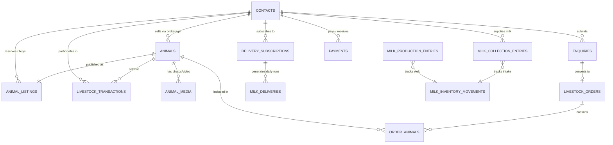

# Purvanchal Dairy & Pashu Kendra — MySQL Database Guide

> **Database Engine**: MySQL 8.0+ / MariaDB 10.5+  
> **Character Set**: `utf8mb4`  
> **Collation**: `utf8mb4_unicode_ci`  
> **Location**: Lar, Deoria, Uttar Pradesh

---

## 1. Entity Relationship Diagram (ERD)



---

## 2. Table Catalog & Data Dictionary

### 2.1 `contacts`
Stores all individuals and organizations interacting with the business (rural suppliers, individual cattle buyers, commercial dairy farm owners, local household consumers).

| Column | Type | Constraints | Description |
|---|---|---|---|
| `id` | `VARCHAR(64)` | `PRIMARY KEY` | Unique ID (e.g. `CONT-001`) |
| `name` | `VARCHAR(191)` | `NOT NULL` | Full Name |
| `phone` | `VARCHAR(32)` | `NOT NULL, INDEX` | Primary phone number |
| `whatsapp` | `VARCHAR(32)` | `NULL` | WhatsApp contact number |
| `location` | `VARCHAR(255)` | `NOT NULL, INDEX` | Village / Town / District |
| `roles` | `JSON` | `NOT NULL` | JSON array of active roles |
| `active` | `BOOLEAN` | `DEFAULT TRUE` | Active/Inactive status |
| `notes` | `TEXT` | `NULL` | Special handling instructions |
| `created_at` | `TIMESTAMP` | `DEFAULT CURRENT_TIMESTAMP` | Record creation date |
| `updated_at` | `TIMESTAMP` | `ON UPDATE CURRENT_TIMESTAMP`| Last update date |

---

### 2.2 `animals`
Stores biological, genetic, and milking verification data for cows and buffaloes.

| Column | Type | Constraints | Description |
|---|---|---|---|
| `id` | `VARCHAR(64)` | `PRIMARY KEY` | Animal unique ID (e.g. `PDPK-BUF-01`) |
| `tag_number` | `VARCHAR(64)` | `UNIQUE, NOT NULL` | Physical ear tag number (e.g. `UP-DEO-8801`) |
| `species` | `ENUM('COW', 'BUFFALO')` | `NOT NULL, INDEX` | Biological species |
| `breed` | `VARCHAR(100)` | `NOT NULL, INDEX` | Breed (e.g. `High Milking Buffalo`, `Milch Cow`) |
| `gender` | `ENUM('FEMALE', 'MALE')` | `DEFAULT 'FEMALE'` | Gender |
| `age_years` | `INT` | `NOT NULL` | Age in years |
| `age_months` | `INT` | `DEFAULT 0` | Additional months |
| `lactation_number` | `INT` | `DEFAULT 1` | 1st, 2nd, 3rd, 4th lactation |
| `calving_details` | `VARCHAR(255)` | `NULL` | Date of calving & calf gender |
| `pregnancy_status` | `VARCHAR(100)` | `NULL` | Open, peak milking, or months pregnant |
| `reported_milk_yield_lpd` | `DECIMAL(5,2)` | `NULL` | Verified daily milk yield in Litres |
| `milk_yield_unit` | `ENUM('LPD', 'LITRES_PER_DAY')` | `DEFAULT 'LPD'` | Measurement unit |
| `yield_verification_date` | `DATE` | `NULL` | Date 2-time milking test was conducted |
| `yield_verification_status` | `ENUM('VERIFIED_ON_FARM', 'SELLER_DECLARED')` | `DEFAULT 'VERIFIED_ON_FARM'` | Verification guarantee level |
| `has_veterinary_check` | `BOOLEAN` | `DEFAULT FALSE` | Lar Vet Hospital inspection status |
| `veterinary_notes` | `TEXT` | `NULL` | Health, vaccination, and teat health notes |
| `ownership_type` | `ENUM('OWNED', 'BROKERAGE')` | `DEFAULT 'OWNED'` | Owned by farm or brokerage sale |
| `seller_contact_id` | `VARCHAR(64)` | `FK -> contacts.id` | External breeder contact ID if brokerage |
| `brokerage_commission`| `DECIMAL(10,2)` | `DEFAULT 0.00` | Agreed brokerage margin in INR |
| `health_notes` | `TEXT` | `NULL` | FMD/HS vaccine, deworming history |

---

### 2.3 `animal_listings`
Manages public pricing, marketplace availability, and buyer reservations.

| Column | Type | Constraints | Description |
|---|---|---|---|
| `id` | `VARCHAR(64)` | `PRIMARY KEY` | Listing ID (e.g. `LIST-001`) |
| `animal_id` | `VARCHAR(64)` | `FK -> animals.id, UNIQUE` | 1-to-1 link with Animal |
| `title` | `VARCHAR(255)` | `NOT NULL` | Public display title |
| `description` | `TEXT` | `NOT NULL` | Full description |
| `price_min` | `DECIMAL(12,2)` | `NOT NULL` | Minimum expected price (INR) |
| `price_max` | `DECIMAL(12,2)` | `NOT NULL` | Maximum asking price (INR) |
| `status` | `ENUM(...)` | `INDEX` | `DRAFT`, `AVAILABLE`, `RESERVED`, `SOLD`, `ARCHIVED` |
| `location` | `VARCHAR(255)` | `NOT NULL` | Farm location (e.g. `Khardaha Nilkanth, Lar, Deoria`) |
| `reservation_deposit` | `DECIMAL(10,2)` | `NULL` | Token amount paid to lock animal |
| `reserved_for_contact_id` | `VARCHAR(64)`| `FK -> contacts.id` | Buyer contact ID holding reservation |
| `sold_price` | `DECIMAL(12,2)` | `NULL` | Final negotiated sales price |
| `sold_to_contact_id` | `VARCHAR(64)` | `FK -> contacts.id` | Final buyer |

---

### 2.4 `enquiries` & `livestock_orders`
Tracks the complete sales conversion pipeline from initial contact to physical cattle delivery.

#### Enquiry Lifecycle States:
1. `NEW_ENQUIRY`: Lead received from website or WhatsApp.
2. `CONTACTED`: Sales team verified customer's requirement.
3. `REQUIREMENT_CONFIRMED`: Animal preference, quantity, and budget matched.
4. `QUOTATION_SENT`: Price per head and vehicle transit estimate provided.
5. `ORDER_CONFIRMED`: Customer committed to purchase; token deposit logged.
6. `VETERINARY_CHECK`: Animal examined by government veterinarian in Lar.
7. `TRANSPORT_ARRANGED`: Straw-bedded transport carrier booked with driver details.
8. `DISPATCHED`: Cattle loaded and in transit.
9. `DELIVERED`: Delivered safely at customer's farm shed; final payment collected.

---

### 2.5 Dairy Operations Tables
- **`milk_production_entries`**: Daily record of milk collected from the farm's own herd (Morning: 4:30–7:00 AM, Evening: 4:30–7:00 PM).
- **`milk_collection_entries`**: Daily record of milk received from local village dairy farmers, with automated pricing based on Fat % and SNF %.
- **`milk_inventory_movements`**: Immutable inventory movement ledger tracking inflows (`OWN_PRODUCTION`, `PURCHASED_ACCEPTED`) and outflows (`RETAIL_DELIVERY`, `BULK_SALE`, `WASTE_SPOILAGE`).
- **`delivery_subscriptions`**: Active customer recurring milk orders with quantity, shift, rate per litre, and billing cycle.
- **`milk_deliveries`**: Daily delivery manifest executed by delivery boys or route vehicles across Deoria and Gorakhpur.
- **`payments`**: Financial ledger tracking all incoming customer payments and outgoing supplier disbursements.

---

## 3. High-Value SQL Analytics Queries

### 3.1 Daily Milk Reconciliation Query
Verifies that total milk collected matches total milk delivered and sold for any specific date:

```sql
SELECT 
    business_date,
    SUM(CASE WHEN direction = 'INFLOW' THEN quantity_litres ELSE 0 END) AS total_inflow_litres,
    SUM(CASE WHEN direction = 'OUTFLOW' THEN quantity_litres ELSE 0 END) AS total_outflow_litres,
    SUM(CASE WHEN direction = 'INFLOW' THEN quantity_litres ELSE -quantity_litres END) AS daily_net_variance
FROM milk_inventory_movements
WHERE business_date = '2026-10-26'
GROUP BY business_date;
```

### 3.2 Available High-Milking Murrah Buffaloes
Returns all verified Murrah buffaloes currently available in the Lar, Deoria stables:

```sql
SELECT 
    a.tag_number,
    al.title,
    a.reported_milk_yield_lpd,
    a.lactation_number,
    a.calving_details,
    al.price_min,
    al.price_max,
    al.location
FROM animals a
JOIN animal_listings al ON a.id = al.animal_id
WHERE a.species = 'BUFFALO'
  AND al.status = 'AVAILABLE'
ORDER BY a.reported_milk_yield_lpd DESC;
```

### 3.3 Daily Doorstep Delivery Manifest for Morning Shift
Generates the delivery run list for the route delivery drivers across Deoria & Gorakhpur:

```sql
SELECT 
    md.id AS delivery_id,
    c.name AS customer_name,
    c.phone,
    c.location AS delivery_address,
    ds.delivery_instructions,
    md.scheduled_quantity_litres,
    md.rate_per_litre,
    md.total_billed_amount,
    md.status
FROM milk_deliveries md
JOIN delivery_subscriptions ds ON md.subscription_id = ds.id
JOIN contacts c ON md.customer_contact_id = c.id
WHERE md.business_date = CURRENT_DATE
  AND md.shift = 'MORNING'
ORDER BY c.location ASC;
```

---

## 4. Backup & Maintenance Procedures

### 4.1 Daily Full Database Backup (Command Line)
```bash
mysqldump -u root -p \
  --single-transaction \
  --routines \
  --triggers \
  --default-character-set=utf8mb4 \
  purvanchal_dairy > backup_purvanchal_dairy_$(date +%Y%m%d).sql
```

### 4.2 Automated Cron Job for Midnight Backup
Add to your Linux server's crontab (`crontab -e`):
```text
0 2 * * * mysqldump -u root -p'YOUR_PASSWORD' purvanchal_dairy | gzip > /var/backups/dairy/purvanchal_$(date +\%F).sql.gz
```

### 4.3 Database Restore
```bash
mysql -u root -p purvanchal_dairy < backup_purvanchal_dairy_20261026.sql
```
